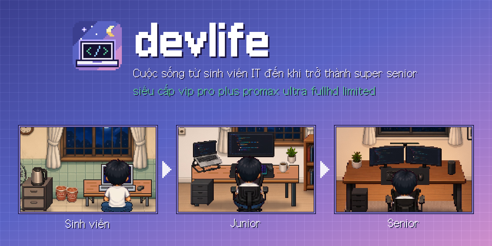

# devlife

[](https://deflife.vercel.app)

Cuộc sống từ sinh viên IT đến khi trở thành super senior siêu cấp vip pro plus promax ultra fullhd limited

A cozy 2D pixel-art developer life-sim for the web: decorate your room as you grow from **student → junior → senior** developer. Play at [deflife.vercel.app](https://deflife.vercel.app).

## Run locally

```bash
pnpm install
pnpm assets          # cut character sprites + build texture atlas (committed outputs included)
pnpm dev             # http://localhost:4317
```

Other commands:

| Command | Purpose |
|---------|---------|
| `pnpm typecheck` | TypeScript |
| `pnpm lint` | ESLint |
| `pnpm test` | Vitest unit tests |
| `pnpm test:e2e` | Playwright (starts dev server) |
| `pnpm assets:check` | Regenerate atlas + validate content |
| `pnpm build && pnpm start` | Production build |

## Milestone 1

- **World resolution:** 427×240 native pixels (`src/game/config.ts` — single source of truth).
- **Rendering:** Canvas2D, integer device-pixel upscale, data-driven layout JSON.
- **State:** Zustand + `localStorage` (`devlife:v1`), per-stage loadouts.
- **UI:** Stage tabs, customize panel (docked ≥1280px, sheet on tablet/desktop, bottom section on portrait mobile).

### Debug overlay

Add `?debug=1` to the URL (or press **D**) to draw anchors, baselines, and room bounds on the scene.

Dev-only full-canvas route: `/debug?stage=student&scale=3&character=1` (404 in production).

### Asset pipeline

```
public/assets/          Source art (rooms, furniture v2, character sheet)
public/atlas/           Generated sprite atlas (devlife.png + devlife.json)
public/assets/character/derived/   Chroma-cut poses (pnpm assets:cut)
scripts/assets/         cut-character.ts, build-atlas.ts, validate.ts
```

Reference renders: `docs/art/expected_*.png` (from `docs/tools/render_preview.py`).

Planning doc: [`docs/PLAN.md`](docs/PLAN.md). Art backlog: [`docs/ART_TODO.md`](docs/ART_TODO.md).

## Folder map

```
src/game/           config, content JSON, layout (resolveScene), view, render, store
src/components/     GameShell, SceneCanvas, CustomizePanel, shadcn/ui
app/                Next.js App Router pages
tests/              unit + e2e
```

Deploys on Vercel with no extra config (static assets + client bundle).
